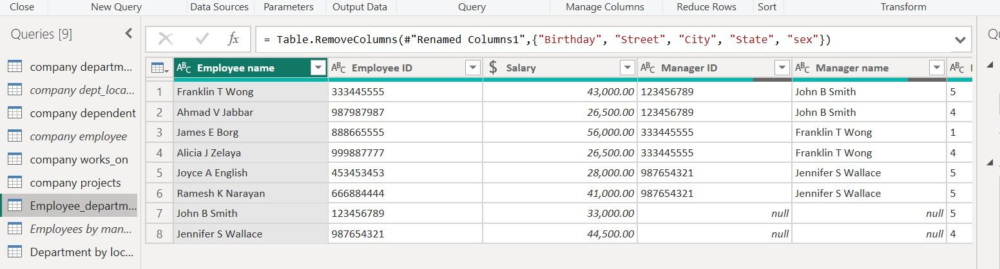
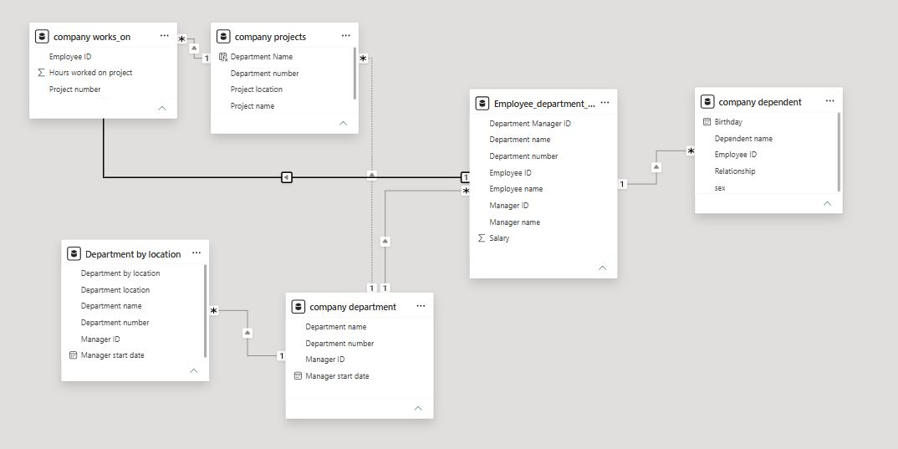
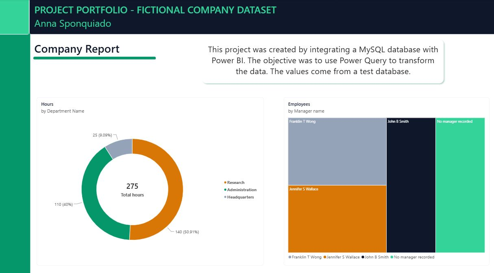

# MySQL to Power BI | Data Transformation Project

**DIO Power BI Bootcamp · Fictional Company Dataset**

This project was part of my DIO Power BI bootcamp, where the challenge was to connect a MySQL database to Power BI and use Power Query to clean, transform and organise the data.

I worked with a fictional company database containing information about employees, departments, projects and their relationships. Rather than focusing on building a detailed dashboard, I wanted to understand how the tables connected, investigate anything unusual in the data and prepare a structure that would be easier to work with.

## Project overview

<table>
  <tr>
    <th width="33%">Power Query</th>
    <th width="33%">Data model</th>
    <th width="33%">Final report</th>
  </tr>
  <tr>
    <td align="center">
      
    </td>
    <td align="center">
      
    </td>
    <td align="center">
      
    </td>
  </tr>
</table>

## Tools

- **MySQL Server & Workbench** – Database setup and exploration
- **Power Query (M)** – Data cleaning, merging, grouping and troubleshooting
- **Power BI Desktop** – Data modelling and visualisation

The original challenge involved connecting to MySQL through Microsoft Azure. I chose to work with a local MySQL database instead, allowing me to focus on the database integration and transformation work without incurring cloud costs.

## Cleaning and transforming the data

I started by exploring the six original tables, checking data types, missing values and how the information was connected.

One of the first things I noticed was that two employees had no manager recorded. Rather than removing those records or filling in the gaps, I checked the employee and department information to understand whether the missing values made sense. I also checked that every department had a valid manager assigned.

I then used Power Query to merge the employee and department tables, bringing the department information into one employee table. I also joined the employee table to itself to retrieve each employee's manager name, combined name fields and separated address information.

For the department locations, I created a separate table containing five unique department–location combinations. This required **Merge rather than Append**, because I needed to match related information across tables, not stack their rows together.

I also grouped employees by manager and reviewed which queries needed to be loaded into the final Power BI model.

## Investigating the data

One thing I particularly enjoyed was following up on values that didn't immediately make sense.

While checking the hours recorded against projects, I found an employee who had zero hours assigned to a project. I followed his employee ID through the employee, department and project tables and confirmed that he was assigned to Project 20 but had no recorded hours.

I decided to keep the value rather than assume it was incorrect. In a real workplace, I would flag it for further investigation, as zero hours could mean the employee hadn't started work or that the information hadn't been entered yet.

Another interesting moment came when I removed an unnecessary column from the original Department table and suddenly caused an error in the merged Department by Location query.

I went into Advanced Editor to investigate the M code and found references to the deleted column. After correcting those, I realised there was also an Applied Step trying to remove the same column again. Removing that step resolved the error, and I checked that the five department–location combinations were still intact.

It was a useful lesson in how Power Query transformations depend on one another and why the order of operations matters.

## Data model and report

Once the transformations were complete, I reviewed the relationships between the tables and kept the original queries that were still needed as staging queries, without loading unnecessary copies into the model.

I also created a simple report to demonstrate the prepared data:

- **Hours by department:** 275 hours recorded across three departments.
- **Employees by manager:** A breakdown of employees by their recorded manager, including a separate category for employees with no manager recorded.

The report wasn't the main objective of the challenge, but it was a useful way to check the results of the transformations.

## What I took away from this project

The most interesting part for me wasn't creating the visuals. It was understanding how the information fitted together, investigating unusual values and figuring out why something wasn't working as expected.

I also became much more comfortable using Power Query, particularly merges, query dependencies and debugging M code.

If there's one thing this project reinforced, it's that **data cleaning isn't just about removing missing or unusual values. It's about understanding what they represent before deciding what to do with them.**

## Project files

- `sql_powerbi_transformation_challenge.pbix` – Power BI project, including Power Query transformations, data model and report.
- Three screenshots showing the transformation, relationships and final report.

**To explore:** Download the `.pbix` file and open it in Power BI Desktop. Refreshing the data requires access to a compatible MySQL database and updated connection settings.

*Note: Salary was stored as Fixed Decimal Number for monetary precision, rather than the double-precision type specified in the original challenge.*
